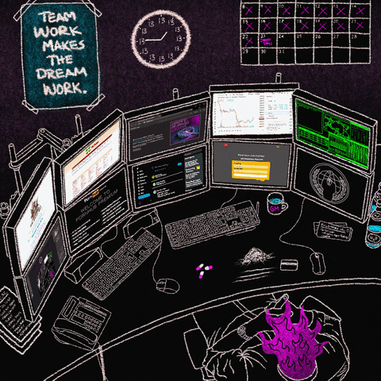

    

  
    
    

  
  
  

 

## 👋 About Me

Building and shipping production web applications. I work across everything from pixel-perfect frontends to scalable backend systems and cloud infrastructure. I care about clean architecture, good performance, and building things that actually work reliably in production, not just in a demo.

 

<table>          
<tr>    
<td width="70%">

I've been building software for 9+ years, and somewhere along the way, engineering became more than just a job for me. I enjoy taking an idea, figuring out how it should work, and turning it into something people can actually use.

I like understanding how things work, solving problems that don't have obvious answers, and constantly learning along the way. Some days that's writing frontend code, other days it's designing a backend system, working with cloud infrastructure, or simply figuring out why something isn't working.

For me, good engineering is about curiosity, patience, and always trying to make things a little better. I care about building reliable software, but I also enjoy the journey of building it.

</td>
<td width="30%">

</td>
</tr>
</table>

## 🛠️ Tech Stack

<h4>🎨 Frontend</h4>

  
  
  
  
  
  
  
  

<h4>⚙️ Backend</h4>

  
  
  
  
  
  
  
  

<h4>☁️ Cloud & DevOps</h4>

  
  
  
  
  
  

<h4>🤖 AI & LLM Tooling</h4>

  
  
  
  

<h4>🧰 Tools</h4>

  
  
  
  

## 🐙 Galaga Preview

<picture>
    
</picture>

---

<!--skils-->

## 🚀 Preferred Skills

<!--chiziqni kodi-->

 

<table align="center">
<tr>
<td align="center" width="96"> React</td>
<td align="center" width="96"> Next.js</td>
<td align="center" width="96"> TypeScript</td>
<td align="center" width="96"> Tailwind</td>
<td align="center" width="96"> Node.js</td>
<td align="center" width="96"> NestJS</td>
</tr>
<tr>
<td align="center" width="96"> GraphQL</td>
<td align="center" width="96"> PostgreSQL</td>
<td align="center" width="96"> MongoDB</td>
<td align="center" width="96"> Docker</td>
<td align="center" width="96"> Kubernetes</td>
<td align="center" width="96"> AWS</td>
</tr>
</table>

 

<!--chiziqni kodi-->

## 🌍 Open Source

<h3 align="center">GirlScript Summer of Code 2026</h3>

  Open Source Contributor • Community Collaborator • Builder

  
  
  

  🏅 Official badges earned during <strong>GirlScript Summer of Code 2026</strong>

 

## ☕ Support My Work

<table>          
<tr>    
<td width="10%"/>

<td width="40%">

</td>
<td width="30%">

</td>
</tr>
</table>

<!--bog`lanish-->

## 📩 Connect With Me

  
  &nbsp;&nbsp;&nbsp;
  
  &nbsp;&nbsp;&nbsp;
  
  &nbsp;&nbsp;&nbsp;
   
  &nbsp;&nbsp;&nbsp;
  
  &nbsp;&nbsp;&nbsp;
  
  &nbsp;&nbsp;&nbsp;
  

